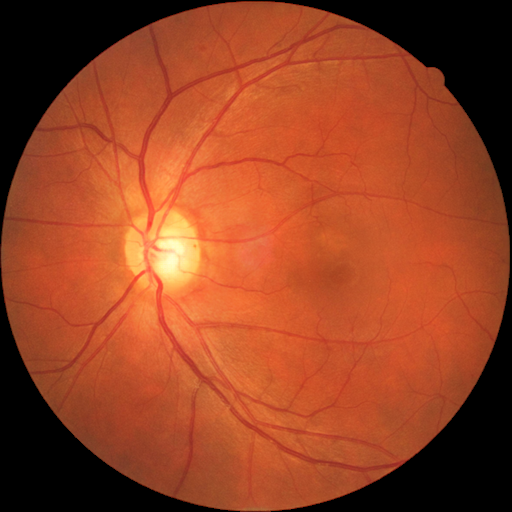
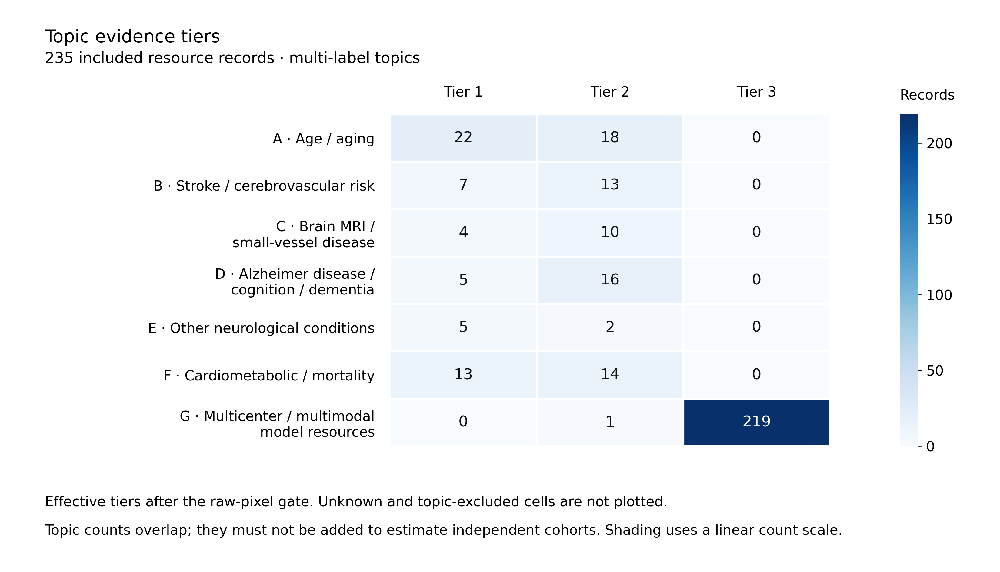

# 全球眼底衰老与眼脑科研数据集 Awesome 资源库

[English](README.md) · [完整目录](catalog/README.md) · [真实图片画廊](assets/examples/README.md) · [统计分析](STATS.md) · [科研指南](library/RESEARCH_GUIDE.md)

以眼底影像与年龄、脑卒中、脑 MRI、神经退行性疾病及全身健康的**个体级关联**为核心。每个资源都有独立介绍页，包含影像与人数口径、临床标签、许可与申请入口、证据链接、局限和建议实验。

基础调查截至 **2026-11-03**，示例图核验日期为 **2026-11-04**。**2026-11-06** 的公开前复核修正了部分评分与许可说明，具体见[变更记录](CHANGELOG.md)；这不表示479条记录全部在该日重新核验。

[公开前审计报告](audit/2026-11-06/REPORT.md)记录科研与许可修正；[公开安全检查](audit/2026-11-06/PUBLICATION_SAFETY.md)记录样例元数据最小化、历史清理和服务器端核验状态。

| 内容 | 数量与范围 |
|---|---|
| 全部资源记录 | 479：EyeDataHub v0.7.0 的451条原始记录 + 28条补充 |
| 纳入研究范围 | 235：Tier 1为23、Tier 2为19、Tier 3为193 |
| 排除记录 | 244，保留理由及来源 |
| 来源深度核验 | 49，其中43条纳入、6条排除；其余430条为目录筛查 |
| 本地图片示例 | 5个资源：4张未经本仓库修改的官方发布图像 + GRAPE完整论文Figure 3 |

资源记录不等于独立患者队列，家族、镜像、派生版本和重复标注不能累加患者人数。某字段已核验，也不意味着该资源的全部字段或申请条件都已确认。

## 如何使用

1. 从[按名称完整目录](catalog/README.md)或[深度核验目录](catalog/reviewed.md)找数据集。每条均有介绍与官方链接。
2. 查看对应专题、影像获取和标签获取，阅读每个 `Confirmed / Uncertain / Not available` 字段的证据与适用范围。
3. 对照[三方向排名](RANKINGS.md)区分科学优先级和近期可开展实验，再阅读[实验设计指南](library/RESEARCH_GUIDE.md)。
4. 下载整个仓库后双击 [`library/index.html`](library/index.html)，使用中英文搜索、条件筛选和证据详情。GitHub 网页中的 HTML 文件是源码预览，需下载后打开。
5. 需要自己的分析时使用[主表CSV](library/output/master.csv)、[表型表](library/output/phenotypes.csv)、[证据表](library/output/evidence.csv)和[SQLite](library/output/resources.sqlite)。

## 七个专题

| 专题 | 索引 |
|---|---|
| A：眼底影像与年龄／衰老 | [查看](catalog/topics/A.md) |
| B：脑卒中／脑血管风险 | [查看](catalog/topics/B.md) |
| C：脑 MRI／脑小血管病 | [查看](catalog/topics/C.md) |
| D：AD／认知功能／痴呆 | [查看](catalog/topics/D.md) |
| E：其他神经系统疾病 | [查看](catalog/topics/E.md) |
| F：心血管／代谢／死亡结局 | [查看](catalog/topics/F.md) |
| G：多中心、多模态与基础模型 | [查看](catalog/topics/G.md) |

Tier 1要求个体级直接关联证据及已建立的影像获取路径；Tier 2保留关联或获取权限尚待确认的候选；Tier 3为辅助影像资源。同一资源可在不同专题具有不同等级。G类资源不自动代表真实多中心采集，更不代表已具备跨机构联邦协作权限。

## 从哪些实验开始

- **年龄与重复测量**：优先查看[GRAPE](datasets/grape.md)、[China-Fundus-CIMT](datasets/china_fundus_cimt.md)、[MCFI](datasets/ext-mcfi.md)，分清年龄监督、重复测量与健康结局；年龄预测误差本身不能确证生物学衰老。
- **眼脑血管研究**：[UK Biobank](datasets/ext-uk-biobank.md)、[ARIC](datasets/ext-aric.md)、[MESA](datasets/ext-mesa.md)、[CHS](datasets/ext-chs.md)值得推进申请或合作。当前没有资源同时满足本库“近期可用影像+卒中终点”全部门槛，CIMT只能支持血管替代指标研究。
- **神经退行性疾病**：[TREND2](datasets/trend2_fundus.md)和[功能OCT/AD](datasets/dryad_functional_oct_alzheimer.md)可用于小样本探索。修正横断面与纵向证据的评分后，科学榜为UKB第1、ARIC第2、CHS与SCONe并列第3；这些大队列仍需解决原始像素与关联权限。AGES的横断面认知资源保留在目录中。

完整得分、并列名次和证据见[排名页](RANKINGS.md)。申请窗口、地域限制与使用条款可能变化，正式实验前按卡片中的官方入口重新确认。

## 图片与统计



Guo Na等，2025；[原始发布v1](https://doi.org/10.6084/m9.figshare.27907056.v1)，[CC0](https://creativecommons.org/publicdomain/zero/1.0/)。发布包中此样本实际为512×512，本仓库未裁剪或重编码。[数据论文](https://www.nature.com/articles/s41597-025-04930-z)说明发布者已做裁剪，并对部分低质量图进行恢复；此张是否经过恢复为Unknown。[查看五图画廊、完整署名及许可](assets/examples/README.md)。其余资源保留官方示例入口，没有批量重新托管影像。



统计单位为纳入的235条资源记录，专题允许多标签。临床字段覆盖图仅分析43条已纳入且深度核验的记录。[全部统计表、访问分布与口径](STATS.md)。

## 复现与维护

```bash
python3 library/src/build.py
python3 library/src/verify.py
python3 scripts/build_catalog.py
python3 scripts/build_rankings.py
python3 scripts/verify_repo.py
```

统计图的依赖与命令见[英文首页](README.md#reproduce-and-update)。完整冻结基线、来源清单、检索日志、字段判断和生成脚本均保留在仓库。[维护说明](CONTRIBUTING.md)要求修改来源输入后再生成页面，避免手工修改导出表造成不一致。

基于[EyeDataHub](https://github.com/pooyakhosravi/EyeDataHub)构建并扩展。使用具体数据时请引用原作者论文与数据版本，遵守其许可与申请条件；本项目许可不替代任何数据集许可。[引用信息](CITATION.cff) · [许可证与第三方声明](LICENSE.md)。
