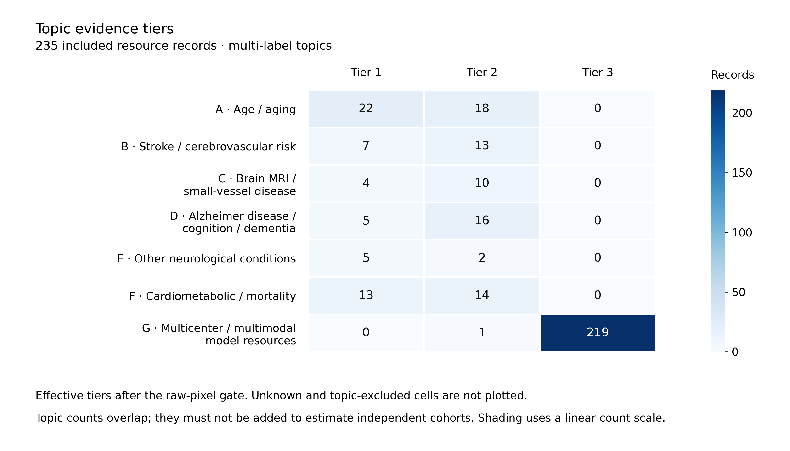
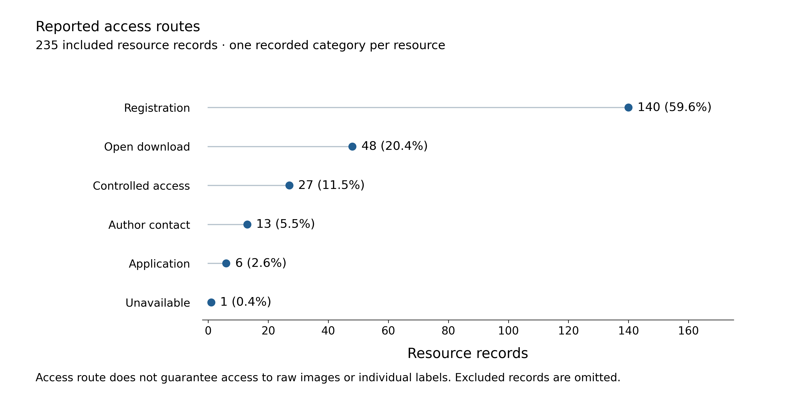
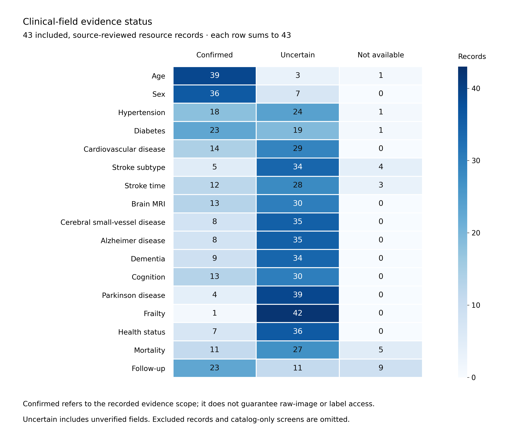

# Repository statistics

Generated from the release CSVs by [`scripts/build_stats.py`](scripts/build_stats.py). These are **resource-record counts, not independent patient-cohort counts**. Mirrors, annotations, releases and derived resources can belong to the same family. No patient total is inferred from these counts.

Latest `checked` date in the input: **2026-11-03**. This is a snapshot date, not a claim that every record or access route was checked on that date.

## Scope and denominators

| Scope | Records |
| --- | ---: |
| All catalog records | 479 |
| EyeDataHub v0.7.0 baseline records | 451 |
| Additional records | 28 |
| Included (`best_tier != Excluded`) | 235 |
| Separate exclusion records | 244 |
| Source-reviewed, all records | 49 |
| Source-reviewed and included | 43 |
| Source-reviewed and excluded | 6 |
| Catalog-screened and included | 192 |

The 244 exclusion records are retained to document decisions; they enter none of the three plotted summaries. **Source-reviewed (49) describes review depth, not confirmation of every field.** The clinical-status figure uses only the 43 included source-reviewed records.

| Best tier among included resources | Records |
| --- | ---: |
| Tier 1 | 23 |
| Tier 2 | 19 |
| Tier 3 | 193 |

## Topic evidence tiers



[SVG](assets/stats/topic_tiers.svg). **Multi-label**: a record may contribute to several topics. The table uses the effective `tier` in `topics.csv` after the raw-pixel availability gate, not `reviewed_tier_before_pixel_gate`. Each row, including Unknown and topic-excluded, sums to 235; topic totals must not be added to obtain a cohort count.

Tier 1 indicates direct individual-level linkage evidence; Tier 2 indicates unresolved access, linkage or necessary permissions; Tier 3 indicates an auxiliary imaging resource. A Tier 3 entry in G does not independently establish multicenter acquisition or readiness for federated learning.

| Topic | Tier 1 | Tier 2 | Tier 3 | Unknown | Topic-excluded |
| --- | ---: | ---: | ---: | ---: | ---: |
| A: Age / aging | 22 | 18 | 0 | 194 | 1 |
| B: Stroke / cerebrovascular risk | 7 | 13 | 0 | 215 | 0 |
| C: Brain MRI / small-vessel disease | 4 | 10 | 0 | 221 | 0 |
| D: Alzheimer disease / cognition / dementia | 5 | 16 | 0 | 213 | 1 |
| E: Other neurological conditions | 5 | 2 | 0 | 228 | 0 |
| F: Cardiometabolic / mortality | 13 | 14 | 0 | 208 | 0 |
| G: Multicenter / multimodal model resources | 0 | 1 | 219 | 15 | 0 |

## Reported access routes



[SVG](assets/stats/access_routes.svg). Access categories are mutually exclusive per resource record. Percentages use 235 included records and are rounded to one decimal place. This field describes the recorded route to a resource; it does **not** guarantee raw image files, individual-level clinical labels, permission to link data, or current eligibility. Consult `image_access`, `label_access`, access conditions and supporting evidence before planning an experiment.

| Access route | Records | Percent of included records |
| --- | ---: | ---: |
| Registration | 140 | 59.6% |
| Open download | 48 | 20.4% |
| Controlled access | 27 | 11.5% |
| Author contact | 13 | 5.5% |
| Application | 6 | 2.6% |
| Unavailable | 1 | 0.4% |

## Clinical-field evidence status



[SVG](assets/stats/clinical_statuses.svg). The denominator is the intersection of `best_tier != Excluded` and `review_depth == Source-reviewed` (43 records). Statuses come from `phenotypes.csv`, without imputing unknown fields. Confirmed is scoped to the cited evidence, which may describe only a subcohort, visit, derived measurement or restricted variable. It is not a guarantee of image-label access. Uncertain includes unverified fields and does not establish absence. Not available follows the recorded evidence scope; these counts are not patient disease prevalences. The figure covers the 17 standard clinical fields; any additional fields are listed in `data.json` and are not plotted.

| Clinical field | Confirmed | Uncertain | Not available |
| --- | ---: | ---: | ---: |
| Age | 39 | 3 | 1 |
| Sex | 36 | 7 | 0 |
| Hypertension | 18 | 24 | 1 |
| Diabetes | 23 | 19 | 1 |
| Cardiovascular disease | 14 | 29 | 0 |
| Stroke subtype | 5 | 34 | 4 |
| Stroke time | 12 | 28 | 3 |
| Brain MRI | 13 | 30 | 0 |
| Cerebral small-vessel disease | 8 | 35 | 0 |
| Alzheimer disease | 8 | 35 | 0 |
| Dementia | 9 | 34 | 0 |
| Cognition | 13 | 30 | 0 |
| Parkinson disease | 4 | 39 | 0 |
| Frailty | 1 | 42 | 0 |
| Health status | 7 | 36 | 0 |
| Mortality | 11 | 27 | 5 |
| Follow-up | 23 | 11 | 9 |

### Source-reviewed exclusions (outside all plotted denominators)

| Resource ID | Resource |
| --- | --- |
| `dryad_huntingtons_retinal_oct` | Huntington retinal OCT study (individual measurements) |
| `ext-yoga-retinal-cognition` | Retinal neurovascular measures and cognition following yoga in older adults |
| `mendeley_neurophysiologic_ophthalmic_markers_chemotherapy_related_cognitive` | Data for: Neurophysiologic and ophthalmic markers of chemotherapy-related cognitive impairment in patients diagnosed with hematologic cancer |
| `mendeley_ophthalmic_stroke_biomarkers_south_asia` | Ophthalmic Stroke Biomarkers in south Asia |
| `parkinsons_directional_oct` | Parkinson directional OCT (Lin; aggregate data) |
| `parkinsons_outer_retinal_structure` | Parkinson outer retinal structure/function (Tran; individual OCT measurements) |

## Reproduce and audit

From the repository root, using Python 3.9 or later:

```bash
python -m venv .venv
source .venv/bin/activate
python -m pip install matplotlib==3.9.4
python scripts/build_stats.py
```

The default input is `library/output/`. To use another release:

```bash
python scripts/build_stats.py --input-dir /path/to/library/output
```

The script overwrites only `assets/stats/{topic_tiers,access_routes,clinical_statuses}.{png,svg}`, `assets/stats/data.json` and this generated page. It checks row identity, category coverage, master/normalized-table agreement and denominators, then renders all figures and checks text overlaps and canvas bounds. A visual inspection of the PNGs is still needed after data or layout changes.

[`data.json`](assets/stats/data.json) contains all plotted tables, denominator IDs, methods, input SHA-256 digests and geometric checks. Counts and tables are deterministic for the same CSV bytes; image bytes can vary with font and rendering-library versions.

| Source CSV | SHA-256 |
| --- | --- |
| [`master.csv`](library/output/master.csv) | `a5bfbd02d32f16839ed42e0a2f8f384598750e19f7f70ebae4ec494f40fe9f4d` |
| [`topics.csv`](library/output/topics.csv) | `e5cbf4a48f5ff0092d04fb7078a2582c5bffa917e1ebb08a8aa69e90f35367c3` |
| [`phenotypes.csv`](library/output/phenotypes.csv) | `3c6a3aa0e2ecb7fbaabc700b5726981db0276ab64333091bb2200b4e9179483f` |
