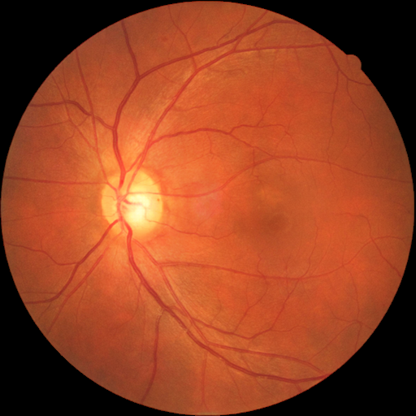

# China-Fundus-CIMT

[All resources](../catalog/README.md) · [Source-reviewed resources](../catalog/reviewed.md)

Metadata as of 2026-11-03 (base survey). Review depth — Source-reviewed. Later targeted corrections are dated in the evidence table and recorded in the [changelog](../CHANGELOG.md).

Source-reviewed 表示已针对选题相关字段查阅原始来源；各字段仍按已确认、待确认和不提供分别记录。

## Overview

双眼、真实年龄、连续 CIMT 及官方患者级划分。

当前核验的影像与模态范围 — Color fundus photography + carotid ultrasound-derived CIMT

Image availability — Open Figshare Fundus\_CIMT\_2903.zip

## Identity and provenance

| Field | Recorded value |
| --- | --- |
| Stable resource ID | china\_fundus\_cimt |
| Name / 名称 | China-Fundus-CIMT |
| Acronym / 缩写 | China-Fundus-CIMT |
| Official resource | [https://doi.org/10.6084/m9.figshare.27907056.v1](https://doi.org/10.6084/m9.figshare.27907056.v1) |
| Country or region / 国家地区 | China |
| Institution / 机构 | Second Affiliated Hospital of Anhui Medical University |
| Reported year / 年份口径 | 2025 |
| Publication date | 2025-04-04 |
| Date scope | initial\_public\_release |
| Date evidence | [https://api.figshare.com/v2/articles/27907056/versions/1](https://api.figshare.com/v2/articles/27907056/versions/1) |
| Date reviewed | 2026-09-11 |
| Original citation | Fu W et al. High-resolution fundus images for ophthalmomics and early cardiovascular disease prediction. Scientific Data (2025). |
| Publication DOI | [10.1038/s41597-025-04930-z](https://doi.org/10.1038/s41597-025-04930-z) |
| Dataset DOI | [10.6084/m9.figshare.27907056.v1](https://doi.org/10.6084/m9.figshare.27907056.v1) |
| Import origin | EyeDataHub v0.7.0 |
| Original EyeDataHub ID | china\_fundus\_cimt |
| Dataset family | china\_fundus\_cimt |
| Family or derivative relation | current\_dataset |
| Independence / overlap | Independence unverified |
| Upstream family ID | china\_fundus\_cimt |
| Upstream resource role | current\_dataset |
| Review depth | Source-reviewed |
| Best recorded topic tier | Tier 1 |
| Latest recorded source review | 2026-11-03 |
| Frozen upstream description | Human fundus and carotid intima-media-thickness measurements. |

## Imaging and cohort

| Field | Recorded value |
| --- | --- |
| Modalities / 影像模态 | Color fundus photography + carotid ultrasound-derived CIMT |
| Images / 图像数及口径 | 5,806 PNGs (EyeDataHub v0.7.0 quantity review, ZIP inventory). |
| Participants / 参与者数及口径 | 2,903 paired inpatients |
| Eyes / 眼别 | Both eyes, \_R and \_L filenames |
| Device / 设备 | Canon CR-2 PLUS AF; Siemens ACUSON S2000 (CIMT only) |
| Resolution / 分辨率 | 512 × 512 pixels in release |
| Quality / 质量控制 | Quality-screened photos; two reviewers verified parsed CIMT values. |
| Multiple visits / 多时点 | No longitudinal outcomes in released dictionary |
| Multiple modalities / 多模态 | Fundus pixels and ultrasound measurements; released file list does not include ultrasound pixels. |
| Multiple centers / 多中心 | No — single endocrinology inpatient cohort |

## Access and reuse

| Field | Recorded value |
| --- | --- |
| Access category / 获取方式 | Open download |
| Access or application route | [https://doi.org/10.6084/m9.figshare.27907056.v1](https://doi.org/10.6084/m9.figshare.27907056.v1) |
| Image files / 影像文件 | Open Figshare Fundus\_CIMT\_2903.zip |
| Individual labels / 个体标签 | Open data\_info.json |
| Data license / 数据许可 | CC0 (Figshare v1 API; EyeDataHub logged CC BY 4.0) |
| Research use / 科研条件 | Figshare v1 lists CC0 for the deposit. Cite descriptor and version. |
| Commercial use / 商业用途 | CC0 declaration on the deposit; no separate commercial restriction listed there. |
| Terms scope | dataset\_files |
| Terms evidence | [https://api.figshare.com/v2/articles/27907056/versions/1](https://api.figshare.com/v2/articles/27907056/versions/1) |
| Upstream route review date | 2026-08-02 |
| Upstream acquisition support | standard\_platform\_supported |
| Upstream access friction | self\_service\_authenticated |

## Research value and experimental design

| Field | Recorded value |
| --- | --- |
| Individual linkage / 个体配对依据 | Patient ID is the JSON key; True\_age in years vs normalized age; right\_eye and left\_eye identify PNGs; thickness is concurrent CIMT in mm. |
| Strengths / 主要优点 | 双眼、真实年龄、连续 CIMT 及官方患者级划分。 |
| Limitations / 关键缺陷 | 内分泌住院样本，单中心。缺乏详细高血压/糖尿病病史及卒中事件。CIMT 是颈动脉替代指标。 |
| Suggested experiments / 建议实验 | 患者级保留原划分，先做年龄回归，再以年龄+性别为对照检验影像对连续 CIMT 的增益。 |
| Retinal Aging suitability | A: 连续年龄。 |
| Stroke / CSVD suitability | B: 仅同期颈动脉 CIMT 风险表型；无脑卒中事件。 |
| AD / Dementia suitability | Unknown |
| Multicenter model suitability | Unknown |
| Screening rationale / 筛查理由 | 连续年龄。 \| 仅同期颈动脉 CIMT 风险表型；无脑卒中事件。 \| 同次住院双眼与颈动脉内中膜厚度。 |

## Topic evidence

| Topic | Image-specific tier | Study tier before image-access review | Rationale | Evidence |
| --- | --- | --- | --- | --- |
| [A · Retinal aging / 眼底年龄与衰老](../catalog/topics/A.md) | Tier 1 | Tier 1 | 连续年龄。 | [p](#evidence-2) |
| [B · Stroke and cerebrovascular risk / 脑卒中与脑血管风险](../catalog/topics/B.md) | Tier 1 | Tier 1 | 仅同期颈动脉 CIMT 风险表型；无脑卒中事件。 | [p](#evidence-2) |
| [C · Brain MRI and CSVD / 脑 MRI 与脑小血管病](../catalog/topics/C.md) | Unknown | Unknown | No topic-specific finding | Unknown |
| [D · Alzheimer’s, cognition and dementia / AD、认知与痴呆](../catalog/topics/D.md) | Unknown | Unknown | No topic-specific finding | Unknown |
| [E · Other neurological diseases / 其他神经系统疾病](../catalog/topics/E.md) | Unknown | Unknown | No topic-specific finding | Unknown |
| [F · Cardiovascular, metabolic and mortality outcomes / 心血管、代谢与死亡](../catalog/topics/F.md) | Tier 1 | Tier 1 | 同次住院双眼与颈动脉内中膜厚度。 | [p](#evidence-2) |
| [G · Multicenter and foundation models / 多中心与基础模型](../catalog/topics/G.md) | Unknown | Unknown | No topic-specific finding | Unknown |

## Clinical phenotypes

| Field | Status | Scope | Evidence |
| --- | --- | --- | --- |
| Age / 年龄 | Confirmed | True\_age；age 是标准化数值。 | [p](#evidence-2) |
| Sex / 性别 | Confirmed | gender | [p](#evidence-2) |
| Hypertension / 高血压 | Not available | Detailed history unavailable. | [p](#evidence-2) |
| Diabetes / 糖尿病 | Not available | Detailed history unavailable. | [p](#evidence-2) |
| Cardiovascular disease / 心血管病 | Uncertain | CIMT is confirmed; clinical cardiovascular event status is not identified in release dictionary. | [p](#evidence-2) |
| Stroke type / 卒中分型 | Not available | No subtype in published release dictionary. | [p](#evidence-2) |
| Stroke timing / 卒中事件时间 | Not available | No incident stroke time field. | [p](#evidence-2) |
| Brain MRI / 脑 MRI | Uncertain | Unknown — no field-specific evidence recorded for this resource/release. | Unknown |
| CSVD / 脑小血管病 | Uncertain | Unknown — no field-specific evidence recorded for this resource/release. | Unknown |
| Alzheimer’s disease / 阿尔茨海默病 | Uncertain | Unknown — no field-specific evidence recorded for this resource/release. | Unknown |
| Dementia / 痴呆 | Uncertain | Unknown — no field-specific evidence recorded for this resource/release. | Unknown |
| Cognition / 认知功能 | Uncertain | Unknown — no field-specific evidence recorded for this resource/release. | Unknown |
| Parkinson’s disease / 帕金森病 | Uncertain | Unknown — no field-specific evidence recorded for this resource/release. | Unknown |
| Frailty / 衰弱 | Uncertain | Unknown — no field-specific evidence recorded for this resource/release. | Unknown |
| Health status / 健康状态 | Uncertain | Unknown — no field-specific evidence recorded for this resource/release. | Unknown |
| Mortality / 死亡结局 | Uncertain | Unknown — no field-specific evidence recorded for this resource/release. | Unknown |
| Follow-up / 纵向随访 | Not available | Table 2 is cross-sectional. | [p](#evidence-2) |
| cimt | Confirmed | Individual carotid intima-media thickness by ultrasound (mm). | [p](#evidence-2) |

## Counting evidence

| Count | Unit | Scope | Evidence basis | Exactness | Source |
| --- | --- | --- | --- | --- | --- |
| 5806 | images | PNG fundus images in the current Figshare version 1 deposit | current\_deposit\_file\_listing | exact | [Quantity source](https://doi.org/10.6084/m9.figshare.27907056.v1) |
| 2 | deposited\_files | Files in the current Figshare version 1 deposit | current\_deposit\_file\_listing | exact | [Quantity source](https://doi.org/10.6084/m9.figshare.27907056.v1) |

## Family and derivative ledger

Unknown — 未记录具体的资源关系边。患者或影像重叠情况仍见 Identity and provenance。

## Research priorities

| Track / endpoint | Science rank / score | Near-term rank / score | R / L / Q / X / M | Denominator | Rationale |
| --- | --- | --- | --- | --- | --- |
| Eye–Stroke — 仅颈动脉壁厚替代指标，无脑卒中事件 | 22 / 47.5 | Not eligible / 70.0 | 2 / 1 / 3 / 4 / 1 | 眼底 × 超声 CIMT | 单中心住院人群；公开双眼、ID与真年龄；CIMT 仅替代终点。 |
| Retinal Aging — 年龄与同期 CIMT | 25 / 57.5 | 2 / 76.25 | 3 / 1 / 3 / 4 / 1 | 人级双眼真实年龄 | 单中心住院人群；公开双眼、ID与真年龄；CIMT 仅替代终点。 |

R 为研究适配，L 为标签丰富度，Q 为队列质量，X 为获取可行性，M 为多中心价值。分项范围 0–4。

## Examples and previews

One color fundus photograph as distributed in the official dataset, with the source filename marking the left eye; this file is 512 × 512 pixels. The descriptor reports cropping to 512 × 512 and restoration of some low-quality images. Whether this specific sample was restored is Unknown. These are unchanged release bytes, not a claim of unprocessed camera output.

| Example metadata | Value |
| --- | --- |
| Asset type | dataset\_sample |
| Modality | Fundus |
| Source | [Official example source](https://doi.org/10.6084/m9.figshare.27907056.v1) |
| License | [CC0-1.0](https://creativecommons.org/publicdomain/zero/1.0/) |
| Attribution | Guo Na, WAN JIN FU, Heng Li, Haoyun Zhang, Tiantian Li, Wei Zhang, Xing Zhong, Tianrong Pan, Fuchun Sun and Ajuan Gong (2025). China Fundus Carotid Intima-Media Thickness dataset, version 1. https://doi.org/10.6084/m9.figshare.27907056.v1. CC0 1.0. |
| License evidence | [Source terms](https://api.figshare.com/v2/articles/27907056/versions/1) — The version-1 dataset API lists license.name=CC0 and the CC0 1.0 URL. This is the dataset license; the related paper has a different license. |
| Modification | None. Source file bytes preserved; only the local filename was changed. |
| Provider preprocessing evidence | [Dataset descriptor](https://www.nature.com/articles/s41597-025-04930-z) |
| Image verification date | 2026-11-04 |
| Scope | Illustrative example. Clinical labels and representativeness require resource-specific evidence. |

## Sources

### base

[Open original source](https://doi.org/10.6084/m9.figshare.27907056.v1)

EyeDataHub v0.7.0 → china\_fundus\_cimt; catalog fields and dated source review, not a new clinical audit.

Recorded check date — 2026-08-02.

### p

[Open original source](https://pmc.ncbi.nlm.nih.gov/articles/PMC11968951/)

Methods, Data records/Table 2 and limitations: bilateral images, patient ID, True\_age, normalized age, sex, CIMT; no detailed hypertension/diabetes history.

Recorded check date — 2026-11-03.

### d

[Open original source](https://api.figshare.com/v2/articles/27907056/versions/1)

Figshare version 1 metadata: data\_info.json (754105 B), Fundus\_CIMT\_2903.zip; license.name=CC0.

Recorded check date — 2026-11-03.

### b

[Open original source](https://github.com/pooyakhosravi/EyeDataHub/blob/v0.7.0/hub/audit/resource_quantity_evidence_2026-08-02.csv)

china\_fundus\_cimt row reports MD5 verification and 5806 PNGs in v1 archive by index authors.

Recorded check date — 2026-11-03.
