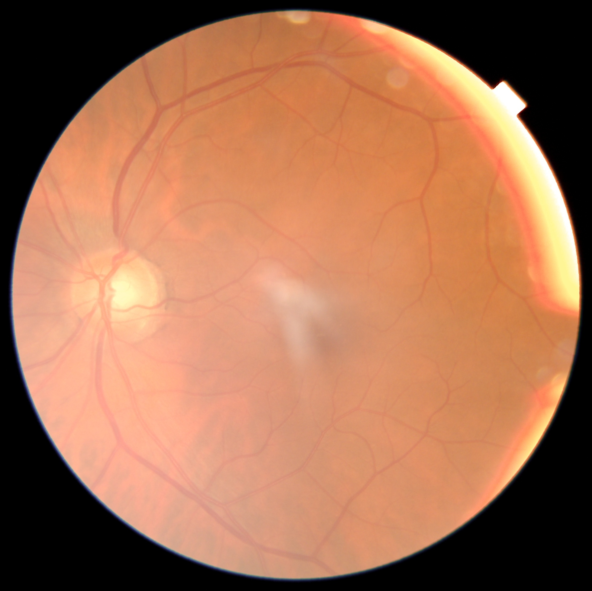

# FDR26 (Morocco)

[All resources](../catalog/README.md) · [Source-reviewed resources](../catalog/reviewed.md)

Metadata as of 2026-11-03 (base survey). Review depth — Source-reviewed. Later targeted corrections are dated in the evidence table and recorded in the [changelog](../CHANGELOG.md).

Source-reviewed 表示已针对选题相关字段查阅原始来源；各字段仍按已确认、待确认和不提供分别记录。

## Overview

提供北非门诊人群及逐患者年龄、糖尿病类型，可检验地理外推。

当前核验的影像与模态范围 — Color fundus photography; model-derived vessel masks

Image availability — Open file Fundus\_FDR26.zip

## Identity and provenance

| Field | Recorded value |
| --- | --- |
| Stable resource ID | ext-fdr26 |
| Name / 名称 | FDR26 (Morocco) |
| Acronym / 缩写 | FDR26 |
| Official resource | [https://zenodo.org/records/23101200](https://zenodo.org/records/23101200) |
| Country or region / 国家地区 | Morocco |
| Institution / 机构 | Mohammed VI University Hospital, Oujda |
| Reported year / 年份口径 | 2026 |
| Publication date | Unknown |
| Date scope | Unknown |
| Date evidence | Unknown |
| Date reviewed | Unknown |
| Original citation | Lamti S et al. FDR26: A Fundus Dataset for Diabetic Retinopathy. Data in Brief, online October 26, 2026. |
| Publication DOI | [10.1016/j.dib.2026.113379](https://doi.org/10.1016/j.dib.2026.113379) |
| Dataset DOI | [10.5281/zenodo.23101200](https://doi.org/10.5281/zenodo.23101200) |
| Import origin | Extension |
| Original EyeDataHub ID | Unknown |
| Dataset family | ext-fdr26 |
| Family or derivative relation | Unknown |
| Independence / overlap | Patient overlap unverified |
| Upstream family ID | Unknown |
| Upstream resource role | Unknown |
| Review depth | Source-reviewed |
| Best recorded topic tier | Tier 1 |
| Latest recorded source review | 2026-11-03 |
| Frozen upstream description | Unknown |

## Imaging and cohort

| Field | Recorded value |
| --- | --- |
| Modalities / 影像模态 | Color fundus photography; model-derived vessel masks |
| Images / 图像数及口径 | 3,000 fundus images |
| Participants / 参与者数及口径 | 1,918 patients |
| Eyes / 眼别 | Unknown |
| Device / 设备 | Unknown |
| Resolution / 分辨率 | Unknown |
| Quality / 质量控制 | Unknown |
| Multiple visits / 多时点 | Unknown |
| Multiple modalities / 多模态 | Unknown |
| Multiple centers / 多中心 | No — one university hospital |

## Access and reuse

| Field | Recorded value |
| --- | --- |
| Access category / 获取方式 | Open download |
| Access or application route | [https://zenodo.org/records/23101200](https://zenodo.org/records/23101200) |
| Image files / 影像文件 | Open file Fundus\_FDR26.zip |
| Individual labels / 个体标签 | Open workbook: 3000 rows, 6 columns (image\_id, classe, grade\_DR, sexe, age, type\_diabete); no separate patient\_id, visit or eye column. |
| Data license / 数据许可 | CC BY 4.0, version 23101200 |
| Research use / 科研条件 | Attribute versioned release and paper; masks derived from another source, check their provenance before reuse. |
| Commercial use / 商业用途 | CC BY 4.0 attribution applies. |
| Terms scope | dataset\_files |
| Terms evidence | [https://zenodo.org/records/23101200](https://zenodo.org/records/23101200) |
| Upstream route review date | Unknown |
| Upstream acquisition support | Unknown |
| Upstream access friction | Unknown |

## Research value and experimental design

| Field | Recorded value |
| --- | --- |
| Individual linkage / 个体配对依据 | Image\_id identifies each image and its age. First nine characters yield 1918 consistent groups but require a provider crosswalk to certify participant identity. External-only testing still needs group-aware uncertainty. |
| Strengths / 主要优点 | 提供北非门诊人群及逐患者年龄、糖尿病类型，可检验地理外推。 |
| Limitations / 关键缺陷 | 单中心且糖尿病筛查富集，非独立血管人工金标准；无事件随访依据。 |
| Suggested experiments / 建议实验 | 锁定训练队列阈值后，按患者评估北非年龄误差、糖尿病分层及校准；先查多图归属。 |
| Retinal Aging suitability | A: 患者年龄 |
| Stroke / CSVD suitability | Unknown |
| AD / Dementia suitability | Unknown |
| Multicenter model suitability | G: 北非独立设备/人群外部域候选。 |
| Screening rationale / 筛查理由 | 患者年龄 \| 糖尿病类型；非前瞻结局。 \| 北非独立设备/人群外部域候选。 |

## Topic evidence

| Topic | Image-specific tier | Study tier before image-access review | Rationale | Evidence |
| --- | --- | --- | --- | --- |
| [A · Retinal aging / 眼底年龄与衰老](../catalog/topics/A.md) | Tier 1 | Tier 1 | 患者年龄 | [p](#evidence-3) |
| [B · Stroke and cerebrovascular risk / 脑卒中与脑血管风险](../catalog/topics/B.md) | Unknown | Unknown | No topic-specific finding | Unknown |
| [C · Brain MRI and CSVD / 脑 MRI 与脑小血管病](../catalog/topics/C.md) | Unknown | Unknown | No topic-specific finding | Unknown |
| [D · Alzheimer’s, cognition and dementia / AD、认知与痴呆](../catalog/topics/D.md) | Unknown | Unknown | No topic-specific finding | Unknown |
| [E · Other neurological diseases / 其他神经系统疾病](../catalog/topics/E.md) | Unknown | Unknown | No topic-specific finding | Unknown |
| [F · Cardiovascular, metabolic and mortality outcomes / 心血管、代谢与死亡](../catalog/topics/F.md) | Tier 1 | Tier 1 | 糖尿病类型；非前瞻结局。 | [p](#evidence-3) |
| [G · Multicenter and foundation models / 多中心与基础模型](../catalog/topics/G.md) | Tier 3 | Tier 3 | 北非独立设备/人群外部域候选。 | [d](#evidence-1) |

## Clinical phenotypes

| Field | Status | Scope | Evidence |
| --- | --- | --- | --- |
| Age / 年龄 | Confirmed | Integer years; 20–85 in file. | [w](#evidence-4) |
| Sex / 性别 | Confirmed | Gender | [p](#evidence-3) |
| Hypertension / 高血压 | Uncertain | Unknown — no field-specific evidence recorded for this resource/release. | Unknown |
| Diabetes / 糖尿病 | Confirmed | Only codes 1 and 2 in type\_diabete; do not infer controls without coding documentation. | [w](#evidence-4) |
| Cardiovascular disease / 心血管病 | Uncertain | Unknown — no field-specific evidence recorded for this resource/release. | Unknown |
| Stroke type / 卒中分型 | Uncertain | Unknown — no field-specific evidence recorded for this resource/release. | Unknown |
| Stroke timing / 卒中事件时间 | Uncertain | Unknown — no field-specific evidence recorded for this resource/release. | Unknown |
| Brain MRI / 脑 MRI | Uncertain | Unknown — no field-specific evidence recorded for this resource/release. | Unknown |
| CSVD / 脑小血管病 | Uncertain | Unknown — no field-specific evidence recorded for this resource/release. | Unknown |
| Alzheimer’s disease / 阿尔茨海默病 | Uncertain | Unknown — no field-specific evidence recorded for this resource/release. | Unknown |
| Dementia / 痴呆 | Uncertain | Unknown — no field-specific evidence recorded for this resource/release. | Unknown |
| Cognition / 认知功能 | Uncertain | Unknown — no field-specific evidence recorded for this resource/release. | Unknown |
| Parkinson’s disease / 帕金森病 | Uncertain | Unknown — no field-specific evidence recorded for this resource/release. | Unknown |
| Frailty / 衰弱 | Uncertain | Unknown — no field-specific evidence recorded for this resource/release. | Unknown |
| Health status / 健康状态 | Uncertain | Unknown — no field-specific evidence recorded for this resource/release. | Unknown |
| Mortality / 死亡结局 | Uncertain | Unknown — no field-specific evidence recorded for this resource/release. | Unknown |
| Follow-up / 纵向随访 | Uncertain | Unknown — no field-specific evidence recorded for this resource/release. | Unknown |

## Counting evidence

Unknown — 本快照没有单独的图像或参与者数量核验表，已知数量及其口径见 Imaging and cohort。

## Family and derivative ledger

Unknown — 未记录具体的资源关系边。患者或影像重叠情况仍见 Identity and provenance。

## Research priorities

| Track / endpoint | Science rank / score | Near-term rank / score | R / L / Q / X / M | Denominator | Rationale |
| --- | --- | --- | --- | --- | --- |
| Retinal Aging — 整数年龄，外部北非人群 | 28 / 51.25 | Not eligible / 63.75 | 3 / 2 / 1 / 3 / 1 | 论文患者数，ID 前缀分组待作者确认 | 开放北非单中心资源，逐图年龄已核实；没有已认证患者键，独立验证暂待分组核准。 |

R 为研究适配，L 为标签丰富度，Q 为队列质量，X 为获取可行性，M 为多中心价值。分项范围 0–4。

## Examples and previews

One color fundus photograph from the classification-image archive. No disease grade is inferred from its appearance; this example does not establish patient-level grouping.

| Example metadata | Value |
| --- | --- |
| Asset type | dataset\_sample |
| Modality | Fundus |
| Source | [Official example source](https://zenodo.org/records/23101200) |
| License | [CC-BY-4.0](https://creativecommons.org/licenses/by/4.0/) |
| Attribution | Sanae Lamti, with Noureddine Kerzazi, Rachid Sekhsoukh and Asmae Guechati (2026). FDR26: A Dataset of Fundus Images for Diabetic Retinopathy Classification and Vessels Segmentation. https://doi.org/10.5281/zenodo.23101200. CC BY 4.0. |
| License evidence | [Source terms](https://zenodo.org/api/records/23101200) — Official versioned Zenodo API metadata.license.id=cc-by-4.0. Selected file is from Fundus\_FDR26.zip, not the separate vessel-mask archive. |
| Modification | None. Source file bytes preserved; only the local filename was changed. |
| Provider preprocessing evidence | Unknown |
| Image verification date | 2026-11-04 |
| Scope | Illustrative example. Clinical labels and representativeness require resource-specific evidence. |

## Sources

### d

[Open original source](https://zenodo.org/records/23101200)

Version-specific deposit, image ZIP, clinical metadata workbook and separate vessel mask archive; descriptions also use FDR25.

Recorded check date — 2026-11-03.

### a

[Open original source](https://zenodo.org/api/records/23101200)

Metadata access\_right=open, license=cc-by-4.0; three named files.

Recorded check date — 2026-11-03.

### p

[Open original source](https://doi.org/10.1016/j.dib.2026.113379)

Abstract: 3000 images, 1918 patients with patient age, gender and diabetes type. Single hospital, four-ophthalmologist consensus DR grading.

Recorded check date — 2026-11-03.

### w

[Open original source](https://zenodo.org/records/23101200/files/metadata_classification_DR.xlsx)

Version-specific workbook, MD5 128b725a17177d38e419993c423ad4b9. Unique image IDs: 3000; integer ages 20–85, 65 distinct. First nine ID characters give 1918 groups, internally consistent for sex/age/diabetes type; no certified patient key.

Recorded check date — 2026-11-03.
