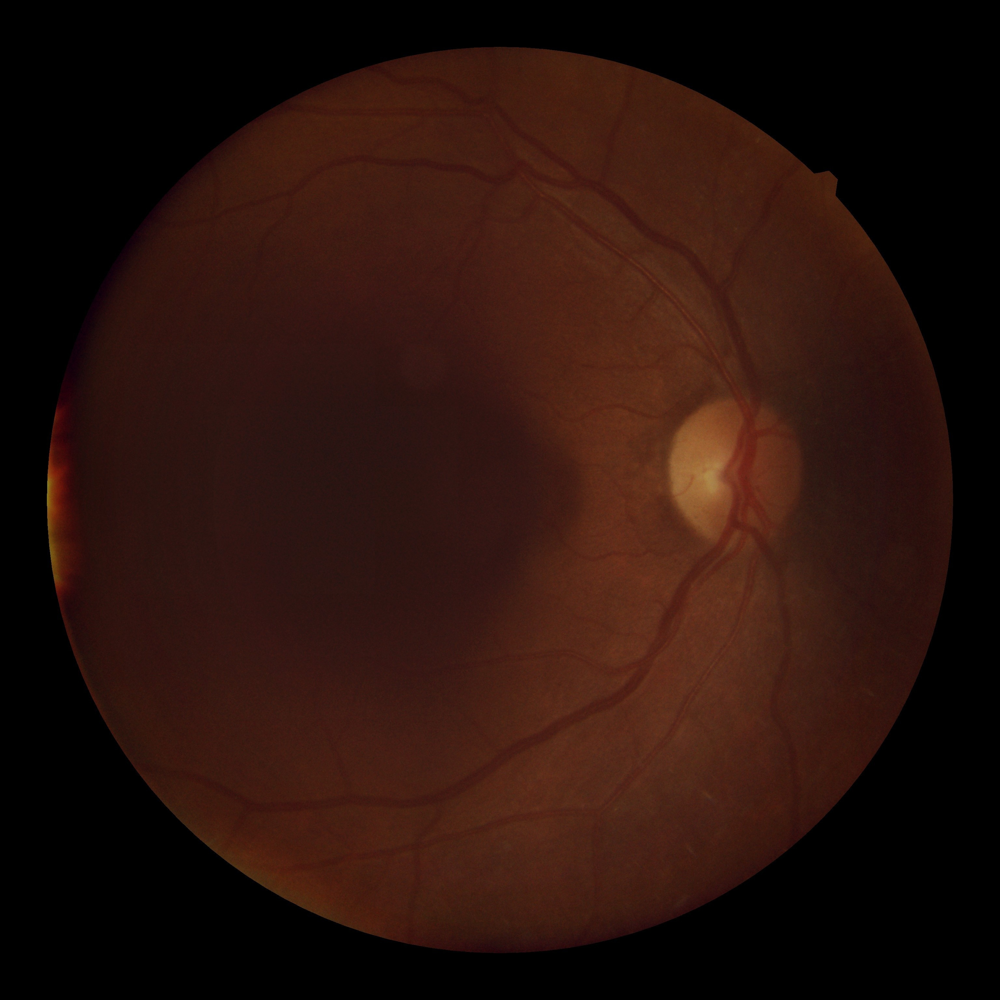

# MCFI: A Multi-Session Colored Fundus Image Dataset

[All resources](../catalog/README.md) · [Source-reviewed resources](../catalog/reviewed.md)

Metadata as of 2026-11-03 (base survey). Review depth — Source-reviewed. Later targeted corrections are dated in the evidence table and recorded in the [changelog](../CHANGELOG.md).

Source-reviewed 表示已针对选题相关字段查阅原始来源；各字段仍按已确认、待确认和不提供分别记录。

## Overview

在小样本内，明确区分同日多张照片与不同日期随访；每位患者至少同眼跨日成像。

当前核验的影像与模态范围 — Color fundus photography

Image availability — 作者公开 ZIP。核验了 目录结构、工作簿和 JPEG 文件名；未检查每张图的像素或全包哈希。

## Identity and provenance

| Field | Recorded value |
| --- | --- |
| Stable resource ID | ext-mcfi |
| Name / 名称 | MCFI: A Multi-Session Colored Fundus Image Dataset |
| Acronym / 缩写 | MCFI |
| Official resource | [https://data.mendeley.com/datasets/stskv6zjt9/1](https://data.mendeley.com/datasets/stskv6zjt9/1) |
| Country or region / 国家地区 | Bangladesh |
| Institution / 机构 | University of Rajshahi |
| Reported year / 年份口径 | 2026 (Mendeley Data v1, 24 September) |
| Publication date | Unknown |
| Date scope | Unknown |
| Date evidence | Unknown |
| Date reviewed | Unknown |
| Original citation | Biswas S, Khan MIA, Choudhury ZZ, et al. MCFI: A Multi-Session Colored Fundus Image Dataset (v1). Mendeley Data, 2026. DOI is for the deposit; associated journal paper Unknown. |
| Publication DOI | Unknown |
| Dataset DOI | [10.17632/stskv6zjt9.1](https://doi.org/10.17632/stskv6zjt9.1) |
| Import origin | Extension |
| Original EyeDataHub ID | Unknown |
| Dataset family | MCFI (Rajshahi) |
| Family or derivative relation | Version v1 primary deposit; no match to superordinate EyeDataHub v0.7.0 family located. |
| Independence / overlap | Patient overlap unverified |
| Upstream family ID | Unknown |
| Upstream resource role | Unknown |
| Review depth | Source-reviewed |
| Best recorded topic tier | Tier 1 |
| Latest recorded source review | 2026-11-03 |
| Frozen upstream description | Unknown |

## Imaging and cohort

| Field | Recorded value |
| --- | --- |
| Modalities / 影像模态 | Color fundus photography |
| Images / 图像数及口径 | 442 color distinct JPEG filenames across 84 participant-dates; OD 214, OS 228 |
| Participants / 参与者数及口径 | 37 participants; 37 have repeat images from the same eye at ≥2 dates; 11 participants have any-eye first-to-last span ≥180 days, 7 ≥365 days |
| Eyes / 眼别 | OD and OS in archive; not every subject has both eyes |
| Device / 设备 | NFC-700 Automatic Non-Mydriatic Retinal Camera, 45° |
| Resolution / 分辨率 | 3072 × 3072 JPEG (depositor) |
| Quality / 质量控制 | Camera-operator notes in participant file; no complete per-image quality grade verified |
| Multiple visits / 多时点 | Yes — 33 participants with 2 dates, 2 with 3, 1 with 5 and 1 with 7; observed spans min/median/max 1/35/1229 days |
| Multiple modalities / 多模态 | No additional imaging modality identified |
| Multiple centers / 多中心 | Single source — University of Rajshahi |

## Access and reuse

| Field | Recorded value |
| --- | --- |
| Access category / 获取方式 | Open download |
| Access or application route | [https://data.mendeley.com/datasets/stskv6zjt9/1](https://data.mendeley.com/datasets/stskv6zjt9/1) |
| Image files / 影像文件 | 作者公开 ZIP。核验了 目录结构、工作簿和 JPEG 文件名；未检查每张图的像素或全包哈希。 |
| Individual labels / 个体标签 | 同包内 metadata.xlsx。有患者键、首次年龄、出生日期、首次/末次会话和自报健康；仅汇总字段信息编入资源库。 |
| Data license / 数据许可 | CC BY 4.0 |
| Research use / 科研条件 | 按 Mendeley Data v1 记录署名。 |
| Commercial use / 商业用途 | CC BY 4.0 无 NC 条款；具体使用遵循许可。 |
| Terms scope | dataset\_files |
| Terms evidence | [https://data.mendeley.com/datasets/stskv6zjt9/1](https://data.mendeley.com/datasets/stskv6zjt9/1) |
| Upstream route review date | Unknown |
| Upstream acquisition support | Unknown |
| Upstream access friction | Unknown |

## Research value and experimental design

| Field | Recorded value |
| --- | --- |
| Individual linkage / 个体配对依据 | MCFI\_Dataset/metadata.xlsx（仓储文字写作 metadata.csv）中 ID 保留前导零，与 JPEG 的 participant ID 一致。实际37/37人的首末日期、日期数、图片数均与文件名重算匹配。年龄表为首次会话整岁10–69，若需访视年龄可用出生日期和成像日期计算；逐访视年龄需标明派生定义。影像获取期2022-09-18 至2026-04-20。 |
| Strengths / 主要优点 | 在小样本内，明确区分同日多张照片与不同日期随访；每位患者至少同眼跨日成像。 |
| Limitations / 关键缺陷 | 样本 37 人，33 人仅2次，随访跨度中位 35 天；单中心单设备。自报慢病字段稀疏，空白不能作阴性。 |
| Suggested experiments / 建议实验 | 按同一眼同日重复 vs 同眼跨日图像分组，估计特征稳定性与年龄误差；患者级 bootstrap；不以短期年龄差解释生理衰老速度。 |
| Retinal Aging suitability | A: 37个 ID 可连接年龄与有日历日期的实际 JPEG。 |
| Stroke / CSVD suitability | Unknown |
| AD / Dementia suitability | Unknown |
| Multicenter model suitability | G: 单设备，适合独立小样本或跨会话稳定性检查。 |
| Screening rationale / 筛查理由 | 37个 ID 可连接年龄与有日历日期的实际 JPEG。 \| 同一个体有自报的糖尿病/心脏病/高血压病程列，但仅3/3/4个非空值，限描述。 \| 单设备，适合独立小样本或跨会话稳定性检查。 |

## Topic evidence

| Topic | Image-specific tier | Study tier before image-access review | Rationale | Evidence |
| --- | --- | --- | --- | --- |
| [A · Retinal aging / 眼底年龄与衰老](../catalog/topics/A.md) | Tier 1 | Tier 1 | 37个 ID 可连接年龄与有日历日期的实际 JPEG。 | [s3](#evidence-3) |
| [B · Stroke and cerebrovascular risk / 脑卒中与脑血管风险](../catalog/topics/B.md) | Unknown | Unknown | No topic-specific finding | Unknown |
| [C · Brain MRI and CSVD / 脑 MRI 与脑小血管病](../catalog/topics/C.md) | Unknown | Unknown | No topic-specific finding | Unknown |
| [D · Alzheimer’s, cognition and dementia / AD、认知与痴呆](../catalog/topics/D.md) | Unknown | Unknown | No topic-specific finding | Unknown |
| [E · Other neurological diseases / 其他神经系统疾病](../catalog/topics/E.md) | Unknown | Unknown | No topic-specific finding | Unknown |
| [F · Cardiovascular, metabolic and mortality outcomes / 心血管、代谢与死亡](../catalog/topics/F.md) | Tier 1 | Tier 1 | 同一个体有自报的糖尿病/心脏病/高血压病程列，但仅3/3/4个非空值，限描述。 | [s3](#evidence-3) |
| [G · Multicenter and foundation models / 多中心与基础模型](../catalog/topics/G.md) | Tier 3 | Tier 3 | 单设备，适合独立小样本或跨会话稳定性检查。 | [s1](#evidence-1) |

## Clinical phenotypes

| Field | Status | Scope | Evidence |
| --- | --- | --- | --- |
| Age / 年龄 | Confirmed | Age at First Session 为首次整数岁，37/37可用（10–69）；可按日期派生后续实足年龄。 | [s3](#evidence-3) |
| Sex / 性别 | Confirmed | Gender，37/37非空。 | [s3](#evidence-3) |
| Hypertension / 高血压 | Confirmed | Hypertension (years)，自报，4/37非空。 | [s3](#evidence-3) |
| Diabetes / 糖尿病 | Confirmed | Diabetes (years)，自报，3/37非空；空白意义未知。 | [s3](#evidence-3) |
| Cardiovascular disease / 心血管病 | Confirmed | Heart Disease (years)，自报，3/37非空，不适合监督验证。 | [s3](#evidence-3) |
| Stroke type / 卒中分型 | Uncertain | Unknown — no field-specific evidence recorded for this resource/release. | Unknown |
| Stroke timing / 卒中事件时间 | Uncertain | Unknown — no field-specific evidence recorded for this resource/release. | Unknown |
| Brain MRI / 脑 MRI | Uncertain | Unknown — no field-specific evidence recorded for this resource/release. | Unknown |
| CSVD / 脑小血管病 | Uncertain | Unknown — no field-specific evidence recorded for this resource/release. | Unknown |
| Alzheimer’s disease / 阿尔茨海默病 | Uncertain | Unknown — no field-specific evidence recorded for this resource/release. | Unknown |
| Dementia / 痴呆 | Uncertain | Unknown — no field-specific evidence recorded for this resource/release. | Unknown |
| Cognition / 认知功能 | Uncertain | Unknown — no field-specific evidence recorded for this resource/release. | Unknown |
| Parkinson’s disease / 帕金森病 | Uncertain | Unknown — no field-specific evidence recorded for this resource/release. | Unknown |
| Frailty / 衰弱 | Uncertain | Unknown — no field-specific evidence recorded for this resource/release. | Unknown |
| Health status / 健康状态 | Confirmed | 治疗、症状及部分自报健康项目，缺失较多。 | [s3](#evidence-3) |
| Mortality / 死亡结局 | Not available | 工作簿不含死亡终点。 | [s3](#evidence-3) |
| Follow-up / 纵向随访 | Confirmed | 84 个患者-拍摄日期；文件名和工作簿首末日期/访视数相符。 | [s3](#evidence-3) |

## Counting evidence

Unknown — 本快照没有单独的图像或参与者数量核验表，已知数量及其口径见 Imaging and cohort。

## Family and derivative ledger

Unknown — 未记录具体的资源关系边。患者或影像重叠情况仍见 Identity and provenance。

## Research priorities

| Track / endpoint | Science rank / score | Near-term rank / score | R / L / Q / X / M | Denominator | Rationale |
| --- | --- | --- | --- | --- | --- |
| Retinal Aging — 同眼短期重测；长期衰老速率样本不足 | 28 / 51.25 | 3 / 75.0 | 3 / 2 / 1 / 4 / 1 | 37 人都有同眼跨日影像，11 人跨度至少180天 | 单中心多间隔，患者/会话/眼别文件映射已核。 |

R 为研究适配，L 为标签丰富度，Q 为队列质量，X 为获取可行性，M 为多中心价值。分项范围 0–4。

## Examples and previews

One distributed right-eye color fundus photograph from an adult participant in the multi-session MCFI dataset. This is one visit image, not a longitudinal sequence.

| Example metadata | Value |
| --- | --- |
| Asset type | dataset\_sample |
| Modality | Fundus |
| Source | [Official example source](https://data.mendeley.com/datasets/stskv6zjt9/1) |
| License | [CC-BY-4.0](https://creativecommons.org/licenses/by/4.0/) |
| Attribution | Sangeeta Biswas, Md. Iqbal Aziz Khan, Zakia Zinat Choudhury, Bimal Kumar Pramanik, Subrata Pramanik, Md Ahanaf Arif Khan, Sanjoy Kumar Chakravarty and Md. Firoz Uddin (2026). MCFI: A Multi-Session Colored Fundus Image Dataset, version 1. https://doi.org/10.17632/stskv6zjt9.1. CC BY 4.0. |
| License evidence | [Source terms](https://data.mendeley.com/datasets/stskv6zjt9/1) — The official version-1 dataset page has a Licence section specifying CC BY 4.0. |
| Modification | None. Source file bytes preserved; only the local filename was changed. |
| Provider preprocessing evidence | Unknown |
| Image verification date | 2026-11-04 |
| Scope | Illustrative example. Clinical labels and representativeness require resource-specific evidence. |

## Sources

### s1

[Open original source](https://data.mendeley.com/datasets/stskv6zjt9/1)

Description/Licence：37人、84次、442图，采集设备、日期命名、单中心、CC BY 4.0。

Recorded check date — 2026-11-03.

### s2

[Open original source](https://data.mendeley.com/public-api/datasets/stskv6zjt9/files?folder_id=root&version=1)

Mendeley v1 files API lists MCFI\_Dataset.zip，584213028 bytes, reported SHA256 ed51d6ea8a2f13c2c0fe359eb0c579ab3d34fe59b88cbffb3852edc86fc8214c。

Recorded check date — 2026-11-03.

### s3

[Open original source](https://data.mendeley.com/public-files/datasets/stskv6zjt9/files/50d1ef9d-ffe7-475d-b9eb-285565fc141d/file_downloaded)

v1 ZIP central directory + metadata.xlsx sheet 'metadata'（仅读公开目录与表，不分发受试者行）：按(ID,YYYYMMDD)而非图片计访视；37个表 ID 与文件 ID 全匹配。年龄10–69、84会话、37人全部同眼跨日至少两次。首末拍摄跨度1/35/1229天(min/median/max)。

Recorded check date — 2026-11-03.
