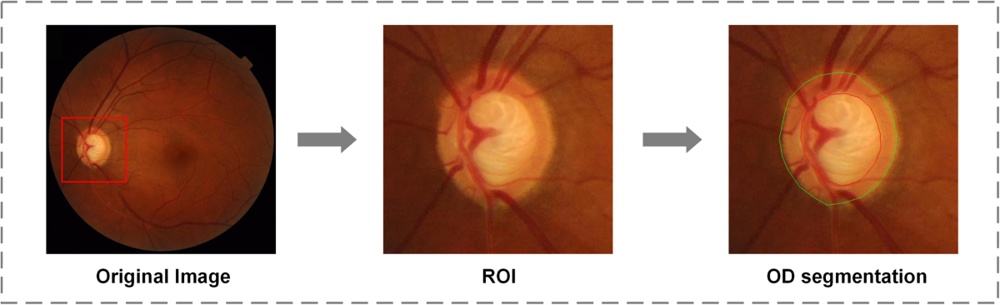

# Glaucoma Real-world Appraisal Progression Ensemble (GRAPE)

[All resources](../catalog/README.md) · [Source-reviewed resources](../catalog/reviewed.md)

Metadata as of 2026-11-03 (base survey). Review depth — Source-reviewed. Later targeted corrections are dated in the evidence table and recorded in the [changelog](../CHANGELOG.md).

Source-reviewed 表示已针对选题相关字段查阅原始来源；各字段仍按已确认、待确认和不提供分别记录。

## Overview

影像、眼别、访视与年龄及随访间隔具备明确关联键；三种相机。

当前核验的影像与模态范围 — Color fundus photography; visual fields; OCT-derived RNFL thickness (no raw OCT payload listed)

Image availability — Figshare CFP component (CFPs.rar); public file listed

## Identity and provenance

| Field | Recorded value |
| --- | --- |
| Stable resource ID | grape |
| Name / 名称 | Glaucoma Real-world Appraisal Progression Ensemble (GRAPE) |
| Acronym / 缩写 | GRAPE |
| Official resource | [https://doi.org/10.6084/m9.figshare.c.6406319](https://doi.org/10.6084/m9.figshare.c.6406319) |
| Country or region / 国家地区 | China |
| Institution / 机构 | Eye Center, Second Affiliated Hospital of Zhejiang University, Hangzhou |
| Reported year / 年份口径 | 2023 |
| Publication date | 2023-08-02 |
| Date scope | initial\_public\_release |
| Date evidence | [https://api.figshare.com/v2/collections/6406319](https://api.figshare.com/v2/collections/6406319) |
| Date reviewed | 2026-09-11 |
| Original citation | Huang X, Kong X, Shen Z, et al. GRAPE: A multi-modal dataset of longitudinal follow-up visual field and fundus images for glaucoma management. Scientific Data 10:520 (2023). |
| Publication DOI | [10.1038/s41597-023-02424-4](https://doi.org/10.1038/s41597-023-02424-4) |
| Dataset DOI | [10.6084/m9.figshare.c.6406319](https://doi.org/10.6084/m9.figshare.c.6406319) |
| Import origin | EyeDataHub v0.7.0 |
| Original EyeDataHub ID | grape |
| Dataset family | grape |
| Family or derivative relation | 每张原图对应 ROI、标注图及 JSON；这些衍生文件勿重复入组。 |
| Independence / overlap | Independence unverified |
| Upstream family ID | grape |
| Upstream resource role | current\_dataset |
| Review depth | Source-reviewed |
| Best recorded topic tier | Tier 1 |
| Latest recorded source review | 2026-11-03 |
| Frozen upstream description | 263 eyes × 1,115 visits. Multi-modal: VF (HFA 24-2), fundus photographs, OCT RNFL, IOP, CCT. Labels: VF progression, OD segmentation, glaucoma stage. |

## Imaging and cohort

| Field | Recorded value |
| --- | --- |
| Modalities / 影像模态 | Color fundus photography; visual fields; OCT-derived RNFL thickness (no raw OCT payload listed) |
| Images / 图像数及口径 | 631 original CFP; 1,115 eye visits; additional 631 ROIs + 631 overlays are derivatives |
| Participants / 参与者数及口径 | 144 glaucoma patients (263 eyes); complete serial-CFP subset Unknown |
| Eyes / 眼别 | Both eye lateralities; not all subjects have two eligible eyes |
| Device / 设备 | Topcon TRC-NW8, Canon CR-2 PLUS AF and CR-2 AF; Cirrus HD-OCT 5000 for RNFL |
| Resolution / 分辨率 | CFP by camera 1556², 2136², 1611² |
| Quality / 质量控制 | Poor quality excluded; one best photo per eye/visit retained |
| Multiple visits / 多时点 | Yes — 3–9 visits per eye; adjacent visits &gt;5 months, not all with CFP |
| Multiple modalities / 多模态 | Yes as CFP + VF + baseline OCT thickness; raw OCT not listed |
| Multiple centers / 多中心 | One Zhejiang University clinical collection; three CFP cameras |

## Access and reuse

| Field | Recorded value |
| --- | --- |
| Access category / 获取方式 | Open download |
| Access or application route | [https://doi.org/10.6084/m9.figshare.c.6406319](https://doi.org/10.6084/m9.figshare.c.6406319) |
| Image files / 影像文件 | Figshare CFP component (CFPs.rar); public file listed |
| Individual labels / 个体标签 | Figshare VF and clinical information.xlsx (public component) |
| Data license / 数据许可 | CC0 1.0 on original CFP and clinical spreadsheet components (each independently verified) |
| Research use / 科研条件 | Figshare 将原始 CFP 和临床工作簿分别标为 CC0。按论文及组件 DOI 引用，其他组件单独核对。 |
| Commercial use / 商业用途 | 这两种组件以 CC0 发布，未另列 NC 限制。 |
| Terms scope | component-specific |
| Terms evidence | [https://api.figshare.com/v2/articles/23575926](https://api.figshare.com/v2/articles/23575926) |
| Upstream route review date | 2026-07-21 |
| Upstream acquisition support | end\_to\_end\_tested |
| Upstream access friction | self\_service\_authenticated |

## Research value and experimental design

| Field | Recorded value |
| --- | --- |
| Individual linkage / 个体配对依据 | 原始 CFP 名=Subject Number\_Laterality\_Visit Number；Baseline 有年龄/性别，Follow-up 有 Interval Years；标记 / 表示该次缺 CFP/OCT。后续年龄应注明为基线年龄加访视间隔。 |
| Strengths / 主要优点 | 影像、眼别、访视与年龄及随访间隔具备明确关联键；三种相机。 |
| Limitations / 关键缺陷 | 基线均为青光眼，且原图只覆盖部分访视；1115 不能用作图像数或可做纵向比较的受试者数。 |
| Suggested experiments / 建议实验 | 核算同眼两次及以上 CFP 的患者数和时间间隔，先验证年龄残差受青光眼进展/相机切换影响程度。 |
| Retinal Aging suitability | A: 基线年龄+眼别和访视时间间隔能够关联部分原始图。 |
| Stroke / CSVD suitability | Unknown |
| AD / Dementia suitability | Unknown |
| Multicenter model suitability | G: 单中心多设备及视野/基线 RNFL，适合表征和设备域试验。 |
| Screening rationale / 筛查理由 | 基线年龄+眼别和访视时间间隔能够关联部分原始图。 \| 单中心多设备及视野/基线 RNFL，适合表征和设备域试验。 |

## Topic evidence

| Topic | Image-specific tier | Study tier before image-access review | Rationale | Evidence |
| --- | --- | --- | --- | --- |
| [A · Retinal aging / 眼底年龄与衰老](../catalog/topics/A.md) | Tier 1 | Tier 1 | 基线年龄+眼别和访视时间间隔能够关联部分原始图。 | [s1](#evidence-2) |
| [B · Stroke and cerebrovascular risk / 脑卒中与脑血管风险](../catalog/topics/B.md) | Unknown | Unknown | No topic-specific finding | Unknown |
| [C · Brain MRI and CSVD / 脑 MRI 与脑小血管病](../catalog/topics/C.md) | Unknown | Unknown | No topic-specific finding | Unknown |
| [D · Alzheimer’s, cognition and dementia / AD、认知与痴呆](../catalog/topics/D.md) | Unknown | Unknown | No topic-specific finding | Unknown |
| [E · Other neurological diseases / 其他神经系统疾病](../catalog/topics/E.md) | Unknown | Unknown | No topic-specific finding | Unknown |
| [F · Cardiovascular, metabolic and mortality outcomes / 心血管、代谢与死亡](../catalog/topics/F.md) | Unknown | Unknown | No topic-specific finding | Unknown |
| [G · Multicenter and foundation models / 多中心与基础模型](../catalog/topics/G.md) | Tier 3 | Tier 3 | 单中心多设备及视野/基线 RNFL，适合表征和设备域试验。 | [s1](#evidence-2) |

## Clinical phenotypes

| Field | Status | Scope | Evidence |
| --- | --- | --- | --- |
| Age / 年龄 | Confirmed | 基线实际年龄；后续访视记相对年数。 | [s1](#evidence-2) |
| Sex / 性别 | Confirmed | Baseline.Gender | [s1](#evidence-2) |
| Hypertension / 高血压 | Uncertain | Unknown — no field-specific evidence recorded for this resource/release. | Unknown |
| Diabetes / 糖尿病 | Uncertain | Unknown — no field-specific evidence recorded for this resource/release. | Unknown |
| Cardiovascular disease / 心血管病 | Uncertain | Unknown — no field-specific evidence recorded for this resource/release. | Unknown |
| Stroke type / 卒中分型 | Uncertain | Unknown — no field-specific evidence recorded for this resource/release. | Unknown |
| Stroke timing / 卒中事件时间 | Uncertain | Unknown — no field-specific evidence recorded for this resource/release. | Unknown |
| Brain MRI / 脑 MRI | Uncertain | Unknown — no field-specific evidence recorded for this resource/release. | Unknown |
| CSVD / 脑小血管病 | Uncertain | Unknown — no field-specific evidence recorded for this resource/release. | Unknown |
| Alzheimer’s disease / 阿尔茨海默病 | Uncertain | Unknown — no field-specific evidence recorded for this resource/release. | Unknown |
| Dementia / 痴呆 | Uncertain | Unknown — no field-specific evidence recorded for this resource/release. | Unknown |
| Cognition / 认知功能 | Uncertain | Unknown — no field-specific evidence recorded for this resource/release. | Unknown |
| Parkinson’s disease / 帕金森病 | Uncertain | Unknown — no field-specific evidence recorded for this resource/release. | Unknown |
| Frailty / 衰弱 | Uncertain | Unknown — no field-specific evidence recorded for this resource/release. | Unknown |
| Health status / 健康状态 | Uncertain | Unknown — no field-specific evidence recorded for this resource/release. | Unknown |
| Mortality / 死亡结局 | Not available | 公开临床工作簿字段列表不含死亡。 | [s1](#evidence-2) |
| Follow-up / 纵向随访 | Confirmed | Follow-up.Interval Years，CFP 仅部分访视可得。 | [s1](#evidence-2) |

## Counting evidence

| Count | Unit | Scope | Evidence basis | Exactness | Source |
| --- | --- | --- | --- | --- | --- |
| 1115 | examinations | Primary quantity reported in the reviewed catalog source | legacy\_catalog\_field | not\_assessed | [Quantity source](https://doi.org/10.6084/m9.figshare.c.6406319) |

## Family and derivative ledger

Unknown — 未记录具体的资源关系边。患者或影像重叠情况仍见 Identity and provenance。

## Research priorities

| Track / endpoint | Science rank / score | Near-term rank / score | R / L / Q / X / M | Denominator | Rationale |
| --- | --- | --- | --- | --- | --- |
| Retinal Aging — 年龄、多访视青光眼 | 14 / 76.25 | 1 / 87.5 | 4 / 2 / 3 / 4 / 2 | 整队列患者，非全部多次 CFP 人数 | 单中心三种相机，开放真实访视与眼别。 |

R 为研究适配，L 为标签丰富度，Q 为队列质量，X 为获取可行性，M 为多中心价值。分项范围 0–4。

## Examples and previews

Complete published Figure 3: a real fundus image, its optic-disc region of interest, and annotated disc/cup contours. This is a paper figure illustrating preprocessing, not an unannotated original dataset file.

| Example metadata | Value |
| --- | --- |
| Asset type | published\_figure |
| Modality | Fundus |
| Source | [Official example source](https://www.nature.com/articles/s41597-023-02424-4/figures/3) |
| License | [CC-BY-4.0](https://creativecommons.org/licenses/by/4.0/) |
| Attribution | Xiaoling Huang, Xiangyin Kong, Ziyan Shen, Jing Ouyang, Yunxiang Li, Kai Jin and Juan Ye (2023). GRAPE: A multi-modal dataset of longitudinal follow-up visual field and fundus images for glaucoma management. Scientific Data 10, 520, Figure 3. https://doi.org/10.1038/s41597-023-02424-4. © The Author(s) 2023, CC BY 4.0. |
| License evidence | [Source terms](https://pmc.ncbi.nlm.nih.gov/articles/PMC10404253/) — The article Open Access permissions specify CC BY 4.0 and include figures unless otherwise credited. Figure 3 has no separate third-party credit or exclusion in the publisher/PMC caption. |
| Modification | None. Source file bytes preserved; only the local filename was changed. |
| Provider preprocessing evidence | Unknown |
| Image verification date | 2026-11-04 |
| Scope | Illustrative example. Clinical labels and representativeness require resource-specific evidence. |

## Sources

### base

[Open original source](https://doi.org/10.6084/m9.figshare.c.6406319)

EyeDataHub v0.7.0 → grape; catalog fields and dated source review, not a new clinical audit.

Recorded check date — 2026-07-21.

### s1

[Open original source](https://www.nature.com/articles/s41597-023-02424-4)

Methods / CFP / Data Records / Table 2: 631 CFP、144人263眼1115访视，CFP和临床表键、缺失标记、各相机分辨率。

Recorded check date — 2026-11-03.

### s2

[Open original source](https://api.figshare.com/v2/articles/23575926)

原图独立组件 metadata: CFPs.rar，许可 CC0。

Recorded check date — 2026-11-03.

### s3

[Open original source](https://api.figshare.com/v2/articles/23674350)

患者访视组件 metadata: VF and clinical information.xlsx，许可 CC0。

Recorded check date — 2026-11-03.
